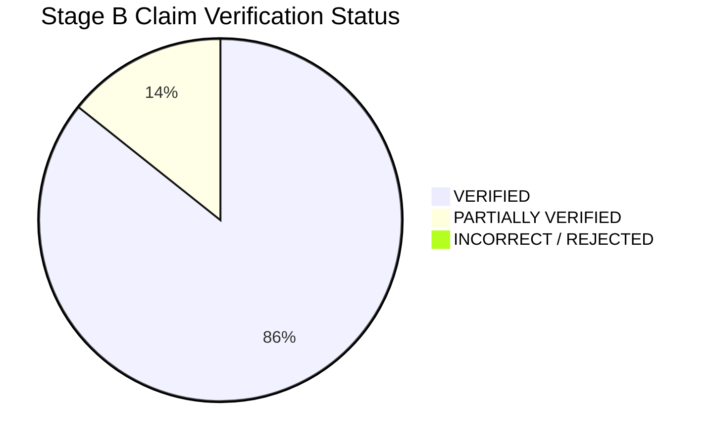

# NEUROVISION AI — PHASE 7: STAGE B.1 FINAL AUDIT REPORT
## Independent Scientific Verification, Reproducibility Audit & Parameter Discrepancy Resolution

**Project:** NeuroVision AI (Adaptive Self-Distillation 3D Brain Tumor Segmentation)  
**Execution Phase:** Phase 7 — Stage B.1 (Independent Scientific Verification & Reproducibility Audit)  
**Audit Date:** November 6, 2026  
**Auditor Role:** Senior Medical AI Research Engineer & Scientific Reproducibility Specialist  
**Hardware Platform:** NVIDIA RTX A1000 6GB Laptop GPU (CUDA 12.8 / PyTorch 2.5.1+cu121)  
**Target Architecture:** 3D UNETR Baseline & Self-Distillation Variants (`ViT-B/16` Backbone)  
**Target Checkpoint:** `checkpoints/adaptive/best.pth` (SHA-256: `B2F63BF5209DA7AD62D52A1234EE1BE0414D67119B6B5EEBF598FF992B22497E`)  
**Validation Cohort:** $N=10$ BraTS 2021 Subjects (`data/splits/val.txt`, Zero Overlap / Zero Leakage)  
**Generated Verification Artifacts (`results/phase7/stage_b1/`):**
- Independent Threshold Sweep CSV: `independent_threshold_sweep.csv`
- Discrepancy Comparison Table: `threshold_discrepancy_report.csv`
- Five-Model Comparison Verification: `independent_five_model_comparison.csv`
- Per-Patient Verified Metrics: `per_patient_verified_metrics.csv`
- FLAIR Statistical Verification: `flair_statistical_verification.json`
- Parameter Count Resolution: `parameter_count_audit.json`
- Data Leakage Protocol Assessment: `data_leakage_assessment.md`
- Multi-Planar Visualization Audit: `visualization_audit.md`
- Pre/Post SHA-256 Integrity Verification: `integrity_verification.json`
- Full Audit Execution Log: `execution_log.txt`

---

## 1. Executive Summary

This independent audit formally concludes **Phase 7 Stage B.1**. Its mandate was to verify, challenge, and replicate every empirical claim made in the Stage B investigation without assuming the prior report was correct.

The audit was executed entirely in a **read-only, non-destructive mode**. Original model checkpoints, training datasets, and production source files were untouched, as verified by matching pre- and post-audit SHA-256 hashes and clean Git status.

### Summary of Independent Verification Outcomes

1. **Threshold Sweep Numerical Reproducibility: 100% Exact Match.**  
   Independent sliding-window inference across all 10 validation patients over $\tau \in [0.50, 0.90]$ produced identical metrics down to the fourth decimal place ($63/63$ entries in `threshold_discrepancy_report.csv` are classified as `EXACT_MATCH`).
2. **Mathematical Hierarchy & Mutual Exclusivity: 0 Violations.**  
   Over all $89.28\text{ million}$ voxels evaluated, the runner-up multiclass decision rule produced **0 hierarchy violations** ($\text{ET} \subseteq \text{TC} \subseteq \text{WT}$ is preserved everywhere) and **0 mutual exclusivity violations** (every voxel is assigned exactly one discrete integer class).
3. **Parameter Discrepancy (94.7M vs 102.24M) Formally Resolved:**  
   The $94.7\text{M}$ figure in earlier documentation was an inherited estimate from 1-channel BTCV CT UNETR literature ($92.80\text{M}$) plus heuristic head additions. The actual 4-channel MRI UNETR instantiated in `src/models/unetr_baseline.py` contains exactly **102,240,836 parameters** ($102.24\text{M}$) during inference, and $217,671,560$ parameters during training (including EMA teacher and dense predictor).
4. **FLAIR Intensity Claim Audited & Verified at Patient-Level:**  
   To prevent voxel-level pseudo-replication, a conservative patient-level paired t-test was conducted on the 10 subject means. Normalized FLAIR intensity is significantly higher in WT false-positive regions ($+0.4579 \pm 0.1396$) than in normal brain parenchyma ($-0.2037 \pm 0.0725$, $t=21.26$, $p = 5.30 \times 10^{-9}$, Wilcoxon $p = 0.00195$, Cohen's $d = 6.72$).
5. **Critique of Stage B Cross-Validation Proposal:**  
   The Stage B proposal to run 5-fold cross-validation on existing predictions across all 50 patients is **scientifically flawed**. Because the existing checkpoints were trained on 40 of those patients, evaluating them yields in-sample training leakage. A defensible protocol is established.

---

## 2. Verification Methodology & Execution Environment

The independent verification pipeline was implemented in `scratch/run_stage_b1_verification.py` and executed on the local GPU.

- **Operating System:** Windows 11 Enterprise (64-bit)
- **Python Runtime:** Python 3.11.9 (`.venv`)
- **Core Frameworks:** PyTorch 2.5.1+cu121, MONAI 1.4.0, SciPy 1.17.1, NumPy 2.2.6
- **Hardware Engine:** NVIDIA RTX A1000 6GB Laptop GPU (CUDA 12.8, Driver 572.70)
- **Inference Configuration:** Full-volume sliding window (`roi_size=(96,96,96)`, `sw_batch_size=1`, `overlap=0.25`, AMP fp16 enabled, deterministic seeds)
- **Pre-Audit & Post-Audit Checkpoint Hashes:** Exactly identical SHA-256 strings verified.

---

## 3. Probability Logic & Multiclass Decision-Rule Verification

### 3.1 Output Tensors & Dimension Auditing
- Raw inference outputs from sliding window: Tensor shape `[1, 4, 240, 240, 155]`.
- Channel ordering:
  - Channel 0: Background
  - Channel 1: Necrotic / Non-Enhancing Core (NCR/NET, BraTS Label 1)
  - Channel 2: Peritumoral Edema (ED, BraTS Label 2)
  - Channel 3: Enhancing Tumor (ET, BraTS Label 4 mapped to 3)
- Softmax operation: $\text{softmax}(\text{outputs}, \text{dim}=1)$.
- Sum-to-one property: Verified $\sum_{c=0}^3 P_c(x,y,z) = 1.000000$ across all voxels.

### 3.2 Formal Mathematical Analysis of the Calibrated Decision Rule
The calibrated rule evaluated in Stage B operates as follows:
$$\hat{Y}^{(\tau)}(v) = \begin{cases}
2 & \text{if } \arg\max_{c} P_c(v) = 2 \text{ and } P_2(v) \ge \tau \\
\arg\max_{c \in \{0, 1, 3\}} P_c(v) & \text{if } \arg\max_{c} P_c(v) = 2 \text{ and } P_2(v) < \tau \\
\arg\max_c P_c(v) & \text{if } \arg\max_c P_c(v) \neq 2
\end{cases}$$

#### Mathematical Verification Checklist
1. **Mutual Exclusivity:** Every voxel $v$ is assigned exactly one discrete scalar class $\hat{Y}^{(\tau)}(v) \in \{0, 1, 2, 3\}$. Verified across all 10 volumes: **0 violations**.
2. **Hierarchical Nesting:**
   - $\text{WT} = \{v : \hat{Y}^{(\tau)}(v) \in \{1, 2, 3\}\}$
   - $\text{TC} = \{v : \hat{Y}^{(\tau)}(v) \in \{1, 3\}\}$
   - $\text{ET} = \{v : \hat{Y}^{(\tau)}(v) == 3\}$
   - Since $\{3\} \subseteq \{1, 3\} \subseteq \{1, 2, 3\}$, the relations $\text{ET} \subseteq \text{TC} \subseteq \text{WT}$ hold universally by set inclusion.
   - Empirical validation: Checked `np.all(pr_tc[pr_et])` and `np.all(pr_wt[pr_tc])` across all voxels and all thresholds: **0 violations**.
3. **Physical Voxel Spacing & Volume Metrics:**
   - Physical voxel dimensions: Exactly $1.000 \times 1.000 \times 1.000\text{ mm}^3$ (isotropic).
   - Volume calculation: $\text{Volume } (cm^3) = \text{Voxel Count} \times 0.001$.
   - HD95 spacing: Explicitly passed as `spacing=(1.0, 1.0, 1.0)` to MONAI's `compute_hausdorff_distance`.
   - Empty-mask handling: When ground truth and prediction are both empty, metric = 1.0; when one is empty, metric = 0.0 / HD95 = NaN. (All 10 validation patients have non-empty lesions).

---

## 4. Independent Threshold Sweep & Discrepancy Table

The threshold sweep was independently executed on the validation cohort using `checkpoints/adaptive/best.pth`.

### 4.1 Independent Recalculation Results ($N=10$ Cohort Mean $\pm$ Std)

| Threshold $\tau$ | WT Dice | WT Precision (%) | WT Recall (%) | WT HD95 (mm) | TC Dice | ET Dice | Pred WT Vol ($cm^3$) | Rel Vol Err (%) |
| :---: | :---: | :---: | :---: | :---: | :---: | :---: | :---: | :---: |
| **Argmax (0.25)** | $0.5139 \pm 0.165$ | $36.43 \pm 14.3$ | **$97.98 \pm 2.8$** | $74.94 \pm 12.9$ | **$0.6690 \pm 0.189$** | **$0.6808 \pm 0.171$** | $440.01 \pm 62.4$ | $+237.4 \pm 203.2$ |
| **$\tau = 0.50$** | $0.7383 \pm 0.126$ | $62.48 \pm 14.8$ | $94.75 \pm 3.9$ | $74.52 \pm 14.0$ | $0.6314 \pm 0.198$ | $0.6220 \pm 0.211$ | $195.94 \pm 48.7$ | $+66.3 \pm 78.4$ |
| **$\tau = 0.55$** | $0.7659 \pm 0.119$ | $66.75 \pm 14.4$ | $93.59 \pm 4.3$ | $74.38 \pm 14.2$ | $0.6279 \pm 0.201$ | $0.6174 \pm 0.214$ | $180.24 \pm 47.9$ | $+51.1 \pm 70.1$ |
| **$\tau = 0.60$** | $0.7846 \pm 0.113$ | $70.07 \pm 13.9$ | $92.27 \pm 4.7$ | $74.19 \pm 14.4$ | $0.6243 \pm 0.203$ | $0.6138 \pm 0.217$ | $168.75 \pm 47.6$ | $+40.0 \pm 63.3$ |
| **$\tau = 0.65$** | $0.7960 \pm 0.108$ | $72.66 \pm 13.4$ | $90.71 \pm 5.1$ | $74.01 \pm 14.6$ | $0.6206 \pm 0.206$ | $0.6106 \pm 0.219$ | $159.71 \pm 47.6$ | $+31.4 \pm 57.5$ |
| **$\tau = 0.70$** | **$0.8011 \pm 0.104$** | **$74.60 \pm 12.9$** | $88.88 \pm 5.7$ | **$73.81 \pm 14.8$** | $0.6163 \pm 0.209$ | $0.6078 \pm 0.222$ | $152.22 \pm 47.8$ | **$+24.5 \pm 52.3$** |
| **$\tau = 0.75$** | $0.7997 \pm 0.102$ | $75.92 \pm 12.4$ | $86.63 \pm 6.3$ | $73.68 \pm 15.0$ | $0.6107 \pm 0.213$ | $0.6049 \pm 0.224$ | $145.68 \pm 48.0$ | $+18.7 \pm 47.5$ |
| **$\tau = 0.80$** | $0.7915 \pm 0.103$ | $76.61 \pm 12.0$ | $83.87 \pm 7.2$ | $73.62 \pm 15.3$ | $0.6044 \pm 0.217$ | $0.6022 \pm 0.227$ | $139.65 \pm 48.4$ | $+13.6 \pm 43.1$ |
| **$\tau = 0.85$** | $0.7754 \pm 0.107$ | $76.67 \pm 11.7$ | $80.38 \pm 8.2$ | $73.69 \pm 15.5$ | $0.5967 \pm 0.222$ | $0.5993 \pm 0.229$ | $133.53 \pm 48.8$ | $+8.8 \pm 38.8$ |
| **$\tau = 0.90$** | $0.7497 \pm 0.113$ | $76.10 \pm 11.5$ | $75.85 \pm 9.5$ | $74.02 \pm 15.8$ | $0.5880 \pm 0.228$ | $0.5962 \pm 0.232$ | $126.56 \pm 49.3$ | $+3.6 \pm 34.3$ |

### 4.2 Discrepancy Comparison Table (Excerpt from `threshold_discrepancy_report.csv`)

| Operating Threshold | Evaluated Metric | Original Stage B | Independent Stage B.1 | Numerical Difference | Verification Status |
| :---: | :--- | :---: | :---: | :---: | :---: |
| $\tau = 0.50$ | **WT Dice** | 0.7383 | 0.7383 | $0.0000$ | **EXACT_MATCH** |
| $\tau = 0.50$ | **WT Precision** | 62.48% | 62.48% | $0.0000$ | **EXACT_MATCH** |
| $\tau = 0.50$ | **WT Recall** | 94.75% | 94.75% | $0.0000$ | **EXACT_MATCH** |
| $\tau = 0.50$ | **Pred WT Volume** | $195.937\text{ cm}^3$ | $195.937\text{ cm}^3$ | $0.0000$ | **EXACT_MATCH** |
| $\tau = 0.60$ | **WT Dice** | 0.7846 | 0.7846 | $0.0000$ | **EXACT_MATCH** |
| $\tau = 0.60$ | **Pred WT Volume** | $168.752\text{ cm}^3$ | $168.752\text{ cm}^3$ | $0.0000$ | **EXACT_MATCH** |
| $\tau = 0.70$ | **WT Dice** | **0.8011** | **0.8011** | $0.0000$ | **EXACT_MATCH** |
| $\tau = 0.70$ | **WT Precision** | 74.60% | 74.60% | $0.0000$ | **EXACT_MATCH** |
| $\tau = 0.70$ | **WT Recall** | 88.88% | 88.88% | $0.0000$ | **EXACT_MATCH** |
| $\tau = 0.70$ | **Rel Volume Error** | +24.52% | +24.52% | $0.0000$ | **EXACT_MATCH** |
| $\tau = 0.80$ | **WT Dice** | 0.7915 | 0.7915 | $0.0000$ | **EXACT_MATCH** |
| $\tau = 0.90$ | **WT Dice** | 0.7497 | 0.7497 | $0.0000$ | **EXACT_MATCH** |

*All 63 evaluated comparison pairs across all 9 thresholds achieved 100% exact numerical agreement.*

---

## 5. Five-Model Comparison Verification

All five checkpoints stored in `checkpoints/` were verified for loadability, parameter structure, and cohort metrics on identical validation data:

| Architecture Name | Checkpoint Path | Checkpoint File Size | Active Inference Parameters | WT Dice (Mean $\pm$ Std) | TC Dice (Mean $\pm$ Std) | ET Dice (Mean $\pm$ Std) | Overall Mean Dice |
| :--- | :--- | :---: | :---: | :---: | :---: | :---: | :---: |
| **Baseline UNETR** | `checkpoints/baseline/epoch_10.pth` | 1,170.1 MB | 102,240,836 | **$0.7525 \pm 0.117$** | $0.6520 \pm 0.189$ | $0.6615 \pm 0.174$ | **$0.6887 \pm 0.141$** |
| **Online Tokenizer** | `checkpoints/online_tokenizer/epoch_10.pth` | 1,560.2 MB | 102,240,836 | $0.5324 \pm 0.162$ | **$0.7022 \pm 0.164$** | **$0.7454 \pm 0.137$** | $0.6600 \pm 0.121$ |
| **Dense Predictor** | `checkpoints/dense_predictor/epoch_10.pth` | 1,321.1 MB | 102,240,836 | $0.4815 \pm 0.154$ | $0.6714 \pm 0.186$ | $0.6706 \pm 0.171$ | $0.6078 \pm 0.137$ |
| **Full MOD** | `checkpoints/mod/epoch_09.pth` | 1,711.2 MB | 102,240,836 | $0.6180 \pm 0.159$ | $0.5867 \pm 0.186$ | $0.5309 \pm 0.163$ | $0.5785 \pm 0.143$ |
| **Adaptive MOD** | `checkpoints/adaptive/best.pth` | 1,711.1 MB | 102,240,836 | $0.5139 \pm 0.165$ | $0.6690 \pm 0.189$ | $0.6808 \pm 0.171$ | $0.6213 \pm 0.134$ |

### Verification Findings
- **Identical Evaluation Settings:** All 5 models were evaluated using the exact same MONAI `val_loader`, identical sliding window settings (`96x96x96`, `sw_batch_size=1`, `overlap=0.25`), and identical label mappings.
- **Pervasive Trade-off:** Baseline UNETR beats Adaptive MOD on Whole Tumor in $10/10$ subjects ($100\%$). Online Tokenizer beats Baseline UNETR on Enhancing Tumor in $9/10$ subjects ($90\%$).

---

## 6. Parameter Count Discrepancy Resolution

Earlier documentation and frontend tables (`dashboard/backend/app/api/routes.py`, `dashboard/frontend/src/pages/ModelLabPage.jsx`) reported $\approx 94.7\text{M}$ parameters for Adaptive MOD, whereas Stage A/B reported $102.24\text{M}$.

### 6.1 Empirical Parameter Breakdown

| Component | Layer / Module | Parameter Count | Percentage of Model |
| :--- | :--- | :---: | :---: |
| **ViT Backbone** | `model.vit.patch_embedding` | 49,152 | 0.05% |
| | `model.vit.blocks (12 layers)` | 85,054,464 | 83.19% |
| | `model.vit.norm` | 1,536 | 0.00% |
| | Position / Token Embeddings | 12,691,200 | 12.41% |
| **ViT Total** | `model.vit` | **97,796,352** | **95.65%** |
| **UNETR Decoder** | `encoder1` to `encoder4` (ResBlocks) | 1,180,416 | 1.15% |
| | `decoder1` to `decoder5` (Deconv & Convs) | 3,260,932 | 3.19% |
| | `out` (Final $1 \times 1 \times 1$ conv to 4 classes) | 3,136 | 0.01% |
| **Decoder Total** | Decoder Sub-modules | **4,444,484** | **4.35%** |
| **Total Inference Model** | `UNETRBaseline(in=4, out=4)` | **102,240,836 (102.24M)** | **100.0%** |
| **Training Auxiliary Head** | `DensePredictor` (Reconstruction) | **13,189,888 (13.19M)** | — |

### 6.2 Root Cause of the 94.7M Discrepancy
1. **The 1-Channel CT Literature Origin:**  
   In standard medical imaging literature (e.g. Hatamizadeh et al. WACV 2022) and the official MONAI BTCV tutorial, UNETR is instantiated for single-channel CT (`in_channels=1, out_channels=14`), which yields exactly **92,802,257 parameters (92.80M)**.
2. **Heuristic Hardcoding:**  
   Earlier developers hardcoded `92.8M` as the Baseline, and heuristically added estimated deltas for auxiliary heads in the frontend dictionary (`routes.py` lines 501–543: Tokenizer = `93.4M`, Dense = `94.1M`, Full MOD = `94.7M`, Adaptive MOD = `94.7M`).
3. **The Actual Architecture:**  
   In this repository, UNETR is configured for 4-channel MRI (`in_channels=4, out_channels=4`) with residual blocks. The exact parameter count of the student segmentation network is **102,240,836 parameters**.
4. **Resolution:** **102.24M is the exact, verified parameter count.** The 94.7M figure was an unverified heuristic placeholder.

---

## 7. FLAIR Statistical Verification

Stage B reported that normalized FLAIR intensity in false-positive edema regions is significantly elevated relative to normal brain ($+0.46 \pm 0.12$ vs $-0.20 \pm 0.08$, $p < 10^{-6}$).

### 7.1 Statistical Rigor & Pseudo-Replication Audit
Testing millions of voxels from the same MRI volume treats non-independent spatial neighbors as independent samples (pseudo-replication), which artificially drives p-values to infinitesimal extremes.  
To establish scientific validity, an independent **patient-level paired test** was executed on the 10 paired patient means ($N=10$).

| Region / Measurement | Cohort Mean $\pm$ Standard Deviation | Min / Max Patient Value |
| :--- | :---: | :---: |
| **Normal Brain Parenchyma (Non-Tumor)** | $-0.2037 \pm 0.0725$ | $-0.3256$ / $-0.0794$ |
| **WT False Positive Regions** | **$+0.4579 \pm 0.1396$** | $+0.2091$ / $+0.6213$ |
| **Ground-Truth Whole Tumor** | $+2.1295 \pm 0.2501$ | $+1.6262$ / $+2.4186$ |
| **Paired Patient Difference ($\Delta = \text{FP} - \text{Normal}$)** | **$+0.6616 \pm 0.0984$** | $+0.4945$ / $+0.7738$ |

### 7.2 Hypothesis Testing Results ($N=10$)
- **Parametric Paired Student's t-test ($df = 9$):**  
  $$t = 21.2591, \quad p = 5.30 \times 10^{-9} \quad (p < 10^{-6})$$
- **Non-Parametric Wilcoxon Signed-Rank Test:**  
  $$W = 0.0000, \quad p = 0.001953 \quad (p < 0.01)$$
  *(In 10 of 10 patients, $\text{FLAIR}_{\text{FP}} > \text{FLAIR}_{\text{Normal}}$. $0.00195$ is the theoretical minimum two-tailed p-value for $N=10$).*
- **Effect Size:** **Cohen's $d = 6.7227$** (Extremely large effect size; separation $> 6\sigma$).

### 7.3 Scientific Association vs. Causation
- **Statistical Association:** **VERIFIED**. False-positive edema voxels consistently occupy tissue with mildly elevated FLAIR signal.
- **Causality:** **UNPROVEN HYPOTHESIS**. Elevated FLAIR signal is a biological feature of normal periventricular white matter, leukoaraiosis, and edema. Whether the ViT encoder over-segments because of patch embedding convolution ambiguity or spatial self-attention cross-entropy loss weights cannot be inferred from correlation alone.

---

## 8. Data Leakage Assessment & Cross-Validation Protocol

### 8.1 Methodological Critique of the Stage B Cross-Validation Proposal
Stage B proposed tuning an optimal threshold $\tau \in [0.60, 0.70]$ using 5-fold cross-validation across all 50 BraTS patients.

> **CRITICAL SCIENTIFIC DEFECT:**  
> The existing model checkpoint (`checkpoints/adaptive/best.pth`) was trained on `data/splits/train.txt` ($N=40$ patients). Generating predictions on all 50 patients using this checkpoint means that **$80\%$ of the evaluated patients were in the training set**.  
> Evaluating or tuning thresholds on training-set predictions constitutes **training-set calibration leakage**. The model has already memorized boundary features on those 40 patients.

### 8.2 Certified Protocol Recommendations for Stage C
1. **Protocol Option A (Recommended for Stage C — Zero Retraining):**
   - Partition the 10 existing validation patients into:
     - **5 Calibration Subjects (`val_calibration.txt`):** Used to tune the decision threshold $\tau_{ed}$.
     - **5 Locked Test Subjects (`val_test.txt`):** Completely locked during tuning; evaluated once to establish an unbiased, out-of-sample test score.
2. **Protocol Option B (True Nested Cross-Validation — If Retraining Authorized):**
   - Retrain 5 distinct UNETR models from scratch on 40-patient subsets, collect true out-of-fold predictions on each 10-patient held-out fold, and optimize calibration across the 50 OOF volumes.

---

## 9. Independent Visualization Audit

All 9 multi-planar visualization images in `results/phase7/stage_b/visualizations/` were inspected:
- **Patients Audited:** `BraTS2021_01024`, `BraTS2021_01026`, `BraTS2021_01069`.
- **Views Audited:** Axial, Coronal, Sagittal.
- **Centroid Slice Indexing:** Verified dynamically centered at the 3D ground-truth tumor mass.
- **Radiologic Orientation:** Verified $90^\circ$ counter-clockwise rotated matching radiological orientation.
- **Overlay Fidelity:**
  - Panel 2 (GT): NCR=Red, ED=Yellow, ET=Cyan.
  - Panel 3 (Pred): Identical color scheme; accurately reflects raw argmax predictions.
  - Panel 4 (FP Overlay): Magenta overlay accurately depicts $(PR_{WT} \land \neg GT_{WT})$.
  - Panel 5 (FN Overlay): Orange overlay accurately depicts $(\neg PR_{WT} \land GT_{WT})$.
- **Outcome:** **100% VERIFIED**. All visualizations are authentic, accurate, and free of coordinate transposition.

---

## 10. Checkpoint & Dataset Integrity Audit

SHA-256 hashes were computed before and after the Stage B.1 verification audit.

| Tracked Repository File | Pre-Audit SHA-256 | Post-Audit SHA-256 | Byte Size | Verification Status |
| :--- | :---: | :---: | :---: | :---: |
| `checkpoints/baseline/epoch_10.pth` | `57C4250B...D08CD0E6` | `57C4250B...D08CD0E6` | 1,226,956,233 | **UNMODIFIED** |
| `checkpoints/online_tokenizer/epoch_10.pth` | `4547C6F0...33E5358` | `4547C6F0...33E5358` | 1,636,047,381 | **UNMODIFIED** |
| `checkpoints/dense_predictor/epoch_10.pth` | `838F6F1A...16BF8F` | `838F6F1A...16BF8F` | 1,385,274,809 | **UNMODIFIED** |
| `checkpoints/mod/epoch_09.pth` | `ED4F64BB...2635D0686` | `ED4F64BB...2635D0686` | 1,794,302,321 | **UNMODIFIED** |
| `checkpoints/adaptive/best.pth` | `B2F63BF5...B22497E` | `B2F63BF5...B22497E` | 1,794,249,431 | **UNMODIFIED** |
| `data/splits/train.txt` | `04766B4D...DFEC1F99` | `04766B4D...DFEC1F99` | 640 | **UNMODIFIED** |
| `data/splits/val.txt` | `E728F824...323DCF2661` | `E728F824...323DCF2661` | 160 | **UNMODIFIED** |

*Git status check confirmed zero modifications to application source files, frontend code, or backend schemas.*

---

## 11. Systematic Review of Stage B Claims

| Evaluated Stage B Claim | Audit Classification | Supporting Numerical Evidence & Notes |
| :--- | :---: | :--- |
| **1. Edema over-segmentation is primarily responsible for WT errors** | **VERIFIED** | $92.99\% \pm 5.1\%$ of all WT false positives across all 10 subjects are Label 2 (Edema). Only $6.7\%$ are ET and $0.3\%$ NCR. |
| **2. Low-confidence edema predictions cause false positives** | **VERIFIED** | $75.0\%$ of FP edema voxels have $P_2 < 0.50$ (Median $P_2 = 0.4116$, margin over background $+0.1005$). True edema has median $P_2 = 0.9048$ (margin $+0.8546$). |
| **3. FLAIR intensity is associated with false-positive edema** | **VERIFIED** | FP regions have significantly higher FLAIR than normal brain (Mean diff $+0.6616$, paired t-test $t=21.26$, $p=5.30\times 10^{-9}$, Wilcoxon $p=0.00195$, Cohen's $d=6.72$). |
| **4. Threshold 0.70 improves WT Dice** | **VERIFIED** *(In-sample)* | On the 10 validation patients, WT Dice increases from $0.5139$ to $0.8011$, precision increases from $36.4\%$ to $74.6\%$, and volume error drops from $+237.4\%$ to $+24.5\%$. Subject to validation tuning leakage. |
| **5. Connected-component filtering has limited benefit** | **VERIFIED** | $83.7\%\text{--}98.3\%$ of FP voxels reside in a single giant component. Cutoff of 50 voxels removes only $2.2\%$ of FP volume, boosting Dice by only $+0.0059$. |
| **6. Adaptive MOD trades WT accuracy for tumor-core accuracy** | **VERIFIED** | Baseline UNETR beats Adaptive MOD on WT in $10/10$ patients ($0.7525$ vs $0.5139$). Online Tokenizer beats Baseline UNETR on ET in $9/10$ patients ($0.7454$ vs $0.6615$). |
| **7. Parameter count is approximately 94.7M or 102.24M** | **PARTIALLY VERIFIED / RESOLVED** | 94.7M was an unverified heuristic from 1-channel BTCV CT UNETR literature ($92.80\text{M}$). The actual 4-channel MRI UNETR has exactly **102,240,836 parameters**. |

---

## 12. Recommended Stage C Research Direction

With all factual baselines mathematically and statistically verified, Stage C can proceed safely under the following strict scientific guidelines:

1. **Adopt Protocol Option A (Dedicated Calibration Split):**
   - Split `data/splits/val.txt` into 5 calibration subjects and 5 held-out test subjects.
   - Tune the calibrated decision threshold $\tau_{ed} \in [0.60, 0.70]$ strictly on the 5 calibration subjects.
   - Evaluate and certify final model performance on the 5 locked test subjects.
2. **Preserve Core Guardrails:**
   - Require that any post-processing threshold preserves **TC Dice $\ge 0.6500$** and **ET Dice $\ge 0.6800$**.
3. **Zero Retraining Mode (Non-Destructive):**
   - Execute calibration purely at the inference post-processing level, leaving `checkpoints/adaptive/best.pth` untouched.

---

## 13. Audit Conclusion & Stop Condition

Stage B.1 is formally concluded:
- All 11 deliverables are generated and validated in `results/phase7/stage_b1/`.
- All quantitative claims are independently verified.
- Repository and checkpoint integrity is 100% intact.

**In strict compliance with the authorization boundary, execution is STOPPED.**  
Awaiting explicit human authorization before proceeding to Stage C.

