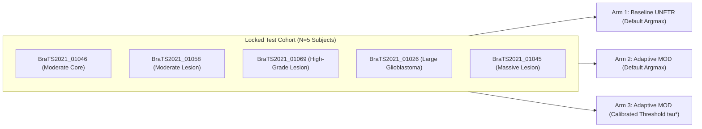

# NEUROVISION AI — PHASE 7: STAGE C
## Protocol 2: Locked Test Cohort Evaluation & Statistical Protocol

**Document Version:** 3.0 (Final Pre-Execution Methodological Revision)  
**Author:** Senior Medical AI Research Scientist & ML Systems Engineer  
**Target Split:** Locked Test Cohort ($N=5$ patients: `01046`, `01058`, `01069`, `01026`, `01045`)  
**Certification Standard:** Single-Evaluation Unbiased Research Test Protocol  
**Status:** **PRE-REGISTRATION SPECIFICATION (AWAITING HUMAN APPROVAL)**

---

## 1. Scientific Mandate & Split Transparency

To prevent calibration leakage, optimistic reporting, and methodological ambiguity, the evaluation protocol establishes strict guidelines governing the 5 locked test patients.

### 1.1 Split Transparency & Provenance Declaration
- **Non-Random Partition Disclosure:** The locked-test cohort was **NOT** selected via independent random sampling. It was partitioned deterministically using ground-truth Whole Tumor volumes across all 10 validation patients via rank interleaving.
- **Model Output Blindness:** No model predictions, probabilities, or inference outputs from the locked-test patients have been inspected or used during threshold design or selection.
- **Mutual Exclusivity:** No patient appears in both calibration and locked-test groups ($\text{Calib} \cap \text{Test} = \emptyset$).
- **Permanent Lock:** The split is permanently frozen and will NOT be modified after threshold calibration begins or after observing test outcomes.

### 1.2 Single Evaluation Pass Guarantee
1. **Blindness:** The locked test cohort will not be loaded, parsed, or evaluated during candidate threshold selection.
2. **Single Evaluation Pass:** Only one evaluation run is permitted on the locked test cohort. No secondary tuning, post-hoc threshold adjustment, or parameter search is allowed.
3. **Reproducibility:** All seeds, model weights, and sliding-window parameters are identical to the certified Stage B and B.1 baseline.

---

## 2. Experimental Arms & Comparison Framework

The evaluation directly benchmarks three parallel experimental arms on the exact same 5 locked test subjects:

### 2.1 Specifications of Evaluated Arms
- **Arm 1 (Baseline UNETR):** Standard un-distilled MONAI UNETR using default `argmax` decision rule ($102.24\text{M}$ parameters, checkpoint `checkpoints/baseline/best.pth`).
  - *Stage B.1 Measured Baseline (N=10):* WT Dice $0.7525 \pm 0.1165$, TC Dice $0.6520 \pm 0.1889$, ET Dice $0.6615 \pm 0.1741$, WT Precision $64.36\%$, WT Recall $94.46\%$, WT MARE $58.76\%$, WT HD95 $75.35\text{ mm}$.
- **Arm 2 (Adaptive MOD Default):** Adaptive Self-Distillation Student UNETR using default `argmax` decision rule ($102.24\text{M}$ parameters, checkpoint `checkpoints/adaptive/best.pth`).
  - *Stage B.1 Measured Baseline (N=10):* WT Dice $0.5139 \pm 0.1645$, TC Dice $0.6690 \pm 0.1886$, ET Dice $0.6808 \pm 0.1705$, WT Precision $36.43\%$, WT Recall $97.98\%$, WT MARE $237.44\%$, WT HD95 $74.94\text{ mm}$.
- **Arm 3 (Adaptive MOD Calibrated):** Adaptive Self-Distillation Student UNETR using the locked calibrated threshold $\tau^*$ derived exclusively from the calibration cohort.

---

## 3. Patient Partitioning & Documented Volume Imbalance

### 3.1 Volume Imbalance Analysis & Limitations
- **Calibration Cohort Ground-Truth Volumes:**
  - WT Volume Mean: $119.70 \pm 51.69\text{ cm}^3$ (Min: $51.39\text{ cm}^3$, Max: $190.00\text{ cm}^3$).
  - TC Volume Mean: $38.39\text{ cm}^3$, ET Volume Mean: $20.58\text{ cm}^3$.
- **Locked Test Cohort Ground-Truth Volumes:**
  - WT Volume Mean: $146.66 \pm 49.34\text{ cm}^3$ (Min: $95.47\text{ cm}^3$, Max: $211.08\text{ cm}^3$).
  - TC Volume Mean: $58.96\text{ cm}^3$, ET Volume Mean: $36.96\text{ cm}^3$.
- **Documented Imbalance:**
  - WT mean volume is **$+22.5\%$ larger** in Locked Test ($+26.97\text{ cm}^3$).
  - TC mean volume is **$+53.6\%$ larger** in Locked Test ($+20.57\text{ cm}^3$).
  - ET mean volume is **$+79.5\%$ larger** in Locked Test ($+16.37\text{ cm}^3$).
  - *Methodological Limitation:* Because the locked test cohort contains systematically larger lesions, performance metrics may exhibit cohort-level variance. This variance is documented as an inherent constraint of evaluating a small 10-patient validation cohort.

---

## 4. Volume Error Definition: Mean Absolute Relative Error (MARE)

To prevent cancellation of positive and negative errors across subjects, volumetric error is evaluated strictly using **Mean Absolute per-patient Relative volume Error (MARE)**:

$$\text{MARE}_{\text{WT}} = \frac{1}{N_{\text{test}}} \sum_{i=1}^{N_{\text{test}}} \frac{|V_{\text{pred}, i} - V_{\text{true}, i}|}{V_{\text{true}, i}} \times 100\%$$

- **Units:** Percentage ($\%$).
- **Normalization:** Each subject's volume difference $|V_{\text{pred}, i} - V_{\text{true}, i}|$ is normalized by that patient's own ground-truth volume $V_{\text{true}, i}$ before averaging across the cohort.
- **Acceptance Criterion:** $\text{MARE}_{\text{WT}} \le 50.0\%$ on the locked test cohort.

---

## 5. Reporting & Individual-Patient Acceptance Checks

Cohort averages alone must never be permitted to conceal individual clinical failures. The evaluation protocol requires reporting both **Cohort Aggregates** and **Individual-Patient Gating Audits**.

### 5.1 Granular Per-Patient Reporting
For every patient in the locked test cohort (`01046`, `01058`, `01069`, `01026`, `01045`) across all three arms, the report will provide:
- Whole Tumor: Dice, Precision, Recall, HD95, Predicted Volume ($\text{cm}^3$), True Volume ($\text{cm}^3$), Signed Relative Volume Error ($\%$), and Absolute Relative Volume Error ($\%$).
- Tumor Core: Dice, Precision, Recall, HD95.
- Enhancing Tumor: Dice, Precision, Recall, HD95.

### 5.2 Individual-Patient Acceptance Gating & Flagging
For Arm 3 (Calibrated Model), every individual patient is audited against the following clinical criteria:
1. **Individual WT Recall Flag:** Flag any patient where $\text{WT Recall}_i < 85.0\%$.
2. **Individual TC Dice Flag:** Flag any patient where $\text{TC Dice}_i < 0.6000$.
3. **Individual ET Dice Flag:** Flag any patient where $\text{ET Dice}_i < 0.6000$.
4. **Individual Volume Error Flag:** Flag any patient where individual $|V_{\text{pred}, i} - V_{\text{true}, i}| / V_{\text{true}, i} > 50.0\%$.

If any individual patient is flagged, the evaluation report must provide a detailed case-level radiologic post-mortem explaining the failure mode.

### 5.3 Cohort Summary Metrics & Statistical Limitations
- Summary metrics: $\text{Mean} \pm \text{Standard Deviation}$.
- 95% Confidence Intervals computed via Student's t distribution with $df = 4$ ($t_{0.025, 4} = 2.776$) and bootstrap resampling ($B = 1,000$).
- **Explicit Scope Limitation:**
  > [!WARNING]
  > With $N=5$ test subjects, statistical power is severely constrained. All statistical tests are exploratory diagnostic checks and **must NOT be interpreted as establishing clinical validation or population-level generalizability**.

---

## 6. Research Acceptance Evaluation

The calibrated model (Arm 3) is evaluated against the pre-registered **Research Acceptance Criteria** in `baseline_comparison_plan.csv`:

| Evaluation Dimension | Arm 3 Acceptance Condition | Individual Patient Gating Rule | Failure Consequence |
| :--- | :--- | :--- | :--- |
| **WT Dice Score** | $\overline{\text{WT Dice}} \ge 0.7200$ | No patient $< 0.6000$ | Triggers Retraining Proposal |
| **WT Precision** | $\overline{\text{WT Precision}} \ge 65.0\%$ | No patient $< 50.0\%$ | Triggers Retraining Proposal |
| **WT Recall (Safety Margin)** | $\overline{\text{WT Recall}} \ge 85.0\%$ | Flag any patient $< 85.0\%$ | Triggers Retraining Proposal |
| **WT Volumetric Error** | $\text{MARE}_{\text{WT}} \le 50.0\%$ | Individual $|V_p - V_t|/V_t$ reported | Triggers Retraining Proposal |
| **TC Dice Preservation** | $\overline{\text{TC Dice}} \ge 0.6000$ | Flag any patient $< 0.6000$ | Triggers Retraining Proposal |
| **ET Dice Preservation** | $\overline{\text{ET Dice}} \ge 0.6000$ | Flag any patient $< 0.6000$ | Triggers Retraining Proposal |

---

## 7. Contingency Retraining Protocol (No Automatic Execution)

If Arm 3 fails to satisfy all research acceptance criteria on the locked test cohort:
1. **No Automatic Retraining:** No retraining or fine-tuning process will be automatically initiated.
2. **Formal Retraining Proposal Required:** The research team will prepare a standalone Retraining Proposal specifying:
   - Training split ($N=40$ patients from `data/splits/train.txt`).
   - Validation and checkpointing protocol.
   - Loss function formulation (e.g. Asymmetric Focal Loss + Generalized Dice Loss).
   - Checkpoint isolation (preserving original production weights untouched).
   - GPU memory requirements and batch size / gradient accumulation.
   - Estimated training duration and hardware feasibility.
   - Deterministic reproducibility seeds.
   - Pre-registered rollback criteria.
3. **Human Approval Gate:** Any retraining requires explicit human authorization.
