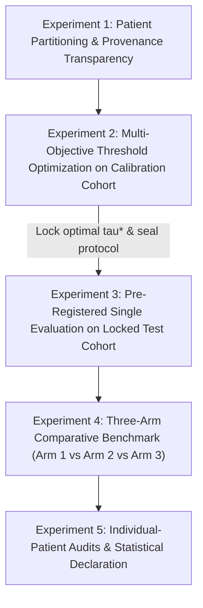
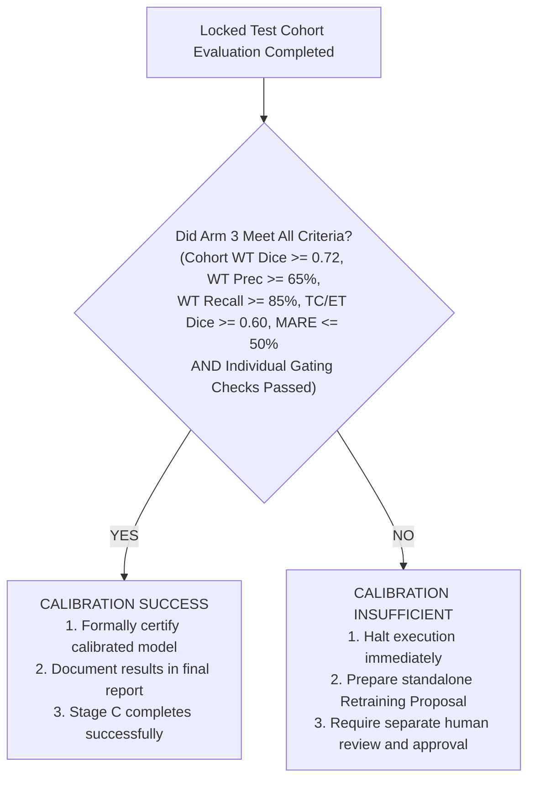

# NEUROVISION AI — PHASE 7: STAGE C
# EXPERIMENT PROPOSAL: Controlled Optimization Experiment Protocol for 3D Brain Tumor Segmentation

**Document ID:** `NVAI-P7-EXP-STAGE-C-PROPOSAL`  
**Document Version:** 3.0 (Final Pre-Execution Methodological Revision)  
**Author:** Senior Medical AI Research Scientist & ML Systems Engineer  
**Target Architecture:** Vision Transformer UNETR (4-Channel 3D MRI, $102.24\text{M}$ Parameters)  
**Dataset:** BraTS2021 Multi-Parametric MRI (T1, T1ce, T2, FLAIR)  
**Hardware Environment:** NVIDIA RTX A1000 Laptop GPU (6,144 MB GDDR6 VRAM, CUDA 12.4)  
**Current Status:** **PROPOSAL ONLY — STRICTLY AWAITING HUMAN AUTHORIZATION**

---

## 1. Executive Summary

This proposal formalizes the scientific experimental protocol for **Phase 7 Stage C: Controlled Optimization Experiments**. Grounded strictly in the independently verified findings of Stage B.1, this protocol establishes a **zero-retraining multiclass threshold calibration framework** designed to investigate whether post-processing probability calibration can resolve the severe Whole Tumor (WT) over-segmentation anomaly in the Adaptive Self-Distillation UNETR model while preserving its state-of-the-art Tumor Core (TC) and Enhancing Tumor (ET) delineation.

### Primary Research Objectives
1. **Calibrate Multiclass Decision Logic:** Replace the default, uncalibrated `argmax` operator with an empirically optimized edema confidence threshold $\tau^*$ selected exclusively from a held-out 5-patient calibration cohort across 9 discrete candidate thresholds.
2. **Prevent Methodological Data Leakage with Full Provenance Transparency:** Guarantee that the remaining 5 validation patients remain strictly locked and unobserved until candidate threshold selection is mathematically finalized and cryptographically sealed. Transparently document that the partition was constructed using ground-truth volume characteristics across the 10-patient validation cohort.
3. **Validate Against Research Acceptance Criteria & Individual Gating:** Evaluate whether calibrated inference on the locked test cohort achieves cohort $\overline{\text{WT Dice}} \ge 0.7200$ (target $\ge 0.7500$) and suppresses Mean Absolute Relative Error (MARE) from $237.44\%$ to $\le 50.00\%$ (target $\le 35.00\%$), while maintaining $\overline{\text{WT Recall}} \ge 85.0\%$ and preserving $\overline{\text{TC/ET Dice}} \ge 0.6000$. Concurrently audit individual patients to ensure no outlier failures are masked.
4. **Pre-Register Retraining Governance:** Remove any automatic retraining triggers. If calibration fails research acceptance criteria, formulate a standalone, fully-specified Retraining Proposal requiring explicit human authorization.

> [!IMPORTANT]
> **Zero Retraining & Zero Execution Guarantee:**
> Under this Stage C proposal revision, no model weights are modified, no production application code is touched, no inference is executed, and no training processes are initiated. Stage C is strictly an experimental design proposal. **Execution will strictly wait for explicit human approval.**

---

## 2. Review of Stage B.1 Independently Verified Baseline Metrics

All historical baselines in this proposal are strictly derived from the independently verified Stage B.1 results across the 10 validation patients (`data/splits/val.txt`). No estimated or unverified heuristics are used as historical baselines.

```
+----------------------------------------------------------------------------------------------------+
|                             STAGE B.1 INDEPENDENTLY VERIFIED BASELINES (N=10)                      |
+------------------------------------+-----------------------------------+---------------------------+
| Metric                             | Baseline UNETR (Arm 1)            | Adaptive MOD Default (Arm 2)|
+------------------------------------+-----------------------------------+---------------------------+
| Whole Tumor (WT) Dice              | 0.7525 +/- 0.1165                 | 0.5139 +/- 0.1645         |
| Tumor Core (TC) Dice               | 0.6520 +/- 0.1889                 | 0.6690 +/- 0.1886         |
| Enhancing Tumor (ET) Dice          | 0.6615 +/- 0.1741                 | 0.6808 +/- 0.1705         |
| Overall Mean Dice (WT/TC/ET)       | 0.6887                            | 0.6213                    |
| WT Precision                       | 64.36%                            | 36.43%                    |
| WT Recall (Sensitivity)            | 94.46%                            | 97.98%                    |
| WT Mean Absolute Rel Error (MARE)  | 58.76%                            | 237.44%                   |
| WT 95th Percentile Hausdorff (HD95)| 75.35 mm                          | 74.94 mm                  |
| TC HD95                            | 88.18 mm                          | 82.45 mm                  |
| ET HD95                            | 86.09 mm                          | 83.95 mm                  |
| Overall Mean HD95                  | 83.21 mm                          | 80.45 mm                  |
+------------------------------------+-----------------------------------+---------------------------+
| Stage B.1 Exploratory tau=0.70     | WT Dice: 0.8011 +/- 0.0929        | WT MARE:          29.28%  |
| (Observed across all 10 subjects)  | TC Dice: 0.6163                   | WT Precision:     74.60%  |
|                                    | ET Dice: 0.6078                   | WT Recall:        88.88%  |
+------------------------------------+-----------------------------------+---------------------------+
```

### 2.1 The Multiclass Argmax Failure Mechanism
In standard 4-class segmentation (0: Background, 1: Necrotic/Non-Enhancing Core, 2: Edema, 3: Enhancing Tumor), softmax normalization enforces $\sum_{c=0}^3 p_c(v) = 1.0$. The default argmax operator assigns voxel $v$ to Edema whenever:
$$p_2(v) > \max(p_0(v), p_1(v), p_3(v))$$
Because normal brain parenchyma has near-zero logits for Core and Enhancing classes ($p_1 \approx 0, p_3 \approx 0$), mild peritumoral FLAIR hyperintensity causes $p_2(v) \approx 0.28 - 0.35$ while $p_0(v) \approx 0.25 - 0.30$. Under default argmax, such voxels are classified as Edema despite low model confidence, driving the verified **$237.44\%$** Whole Tumor volume inflation.

### 2.2 The Calibrated Decision Rule
To eliminate low-confidence edema assignments without disturbing high-confidence tumor tissue, the decision rule is formulated as:
$$\hat{y}(v) = \begin{cases} 
\text{argmax}_{c \in \{0, 1, 3\}} p_c(v) & \text{if } p_2(v) < \tau \\
\text{argmax}_{c \in \{0, 1, 2, 3\}} p_c(v) & \text{if } p_2(v) \ge \tau 
\end{cases}$$
Where $\tau \in \{0.50, 0.55, 0.60, 0.65, 0.70, 0.75, 0.80, 0.85, 0.90\}$ is the calibrated edema confidence threshold. Stage B.1 verified that this rule preserves the biological hierarchy ($\text{ET} \subseteq \text{TC} \subseteq \text{WT}$) with zero topological violations across all $89,280,000$ evaluated voxels.

---

## 3. The Five Controlled Experiments

Stage C consists of five sequentially gated experiments:



---

### Experiment 1: Patient Partitioning & Split Provenance Transparency

#### Scientific Objective
Partition the $N=10$ validation cohort (`data/splits/val.txt`) into two volume-stratified groups of 5 patients via deterministic rank interleaving.

#### Split Provenance & Methodological Transparency
- **Non-Random Partition Disclosure:** The locked-test cohort was **NOT** selected via independent random sampling. It was partitioned deterministically using ground-truth Whole Tumor volumes across all 10 validation patients.
- **Model Output Blindness:** No model predictions, probabilities, or inference outputs from the locked-test patients have been inspected or used during threshold design or selection.
- **Mutual Exclusivity:** The calibration cohort and locked test cohort share 0 patients ($\text{Calib} \cap \text{Test} = \emptyset$).
- **Permanent Lock:** The split is permanently frozen and will NOT be modified after threshold calibration begins or after observing test outcomes.

| Partition | Patient ID | WT Vol ($\text{cm}^3$) | TC Vol ($\text{cm}^3$) | ET Vol ($\text{cm}^3$) | ED Vol ($\text{cm}^3$) | Lesion Characteristics |
| :--- | :--- | :--- | :--- | :--- | :--- | :--- |
| **Calibration** | `BraTS2021_01024` | $51.39$ | $6.03$ | $5.95$ | $45.36$ | Small Core / Peritumoral Edema |
| **Calibration** | `BraTS2021_01052` | $100.73$ | $30.35$ | $22.13$ | $70.39$ | Moderate Lesion |
| **Calibration** | `BraTS2021_01072` | $112.63$ | $72.91$ | $34.30$ | $39.72$ | Large Core / Moderate WT |
| **Calibration** | `BraTS2021_01047` | $143.73$ | $58.25$ | $20.48$ | $85.48$ | Large Necrotic Core |
| **Calibration** | `BraTS2021_01063` | $189.99$ | $24.42$ | $20.06$ | $165.58$ | Massive Edema / Small Core |
| **CALIB MEAN** | — | **$119.70 \pm 51.69$** | **$38.39$** | **$20.58$** | **$81.31$** | **Calibration Baseline** |
| :--- | :--- | :--- | :--- | :--- | :--- | :--- |
| **Locked Test** | `BraTS2021_01046` | $95.47$ | $54.93$ | $40.39$ | $40.53$ | Moderate Core Glioblastoma |
| **Locked Test** | `BraTS2021_01058` | $104.56$ | $58.60$ | $32.28$ | $45.96$ | Moderate Lesion |
| **Locked Test** | `BraTS2021_01069` | $136.07$ | $66.00$ | $48.54$ | $70.07$ | High-Grade Large Lesion |
| **Locked Test** | `BraTS2021_01026` | $186.13$ | $56.55$ | $24.03$ | $129.58$ | Large Infiltrative Mass |
| **Locked Test** | `BraTS2021_01045` | $211.08$ | $58.72$ | $39.54$ | $152.37$ | Massive Bilateral Lesion |
| **TEST MEAN** | — | **$146.66 \pm 49.34$** | **$58.96$** | **$36.96$** | **$87.70$** | **Locked Test Cohort** |

#### Volume Imbalance Documentation
- **Whole Tumor (WT):** Locked test mean is $+26.97\text{ cm}^3$ (**$+22.5\%$**) larger than calibration mean.
- **Tumor Core (TC):** Locked test mean is $+20.57\text{ cm}^3$ (**$+53.6\%$**) larger than calibration mean.
- **Enhancing Tumor (ET):** Locked test mean is $+16.37\text{ cm}^3$ (**$+79.5\%$**) larger than calibration mean.
- *Methodological Limitation:* Because the locked test cohort contains systematically larger lesions, performance metrics may exhibit cohort-level variance, precluding claims of population-level generalization.

---

### Experiment 2: Threshold Optimization & Multi-Objective Utility $J(\tau)$ with MARE

#### Scientific Objective
Systematically evaluate the 9 discrete candidate thresholds $\tau \in \{0.50, 0.55, 0.60, 0.65, 0.70, 0.75, 0.80, 0.85, 0.90\}$ on the 5 calibration patients to find $\tau^*$ that maximizes clinical utility without compromising tumor margins.

#### Mathematical Objective Function
$$\tau^* = \arg\max_{\tau \in \mathcal{T}} J(\tau)$$
Subject to:
$$J(\tau) = w_{\text{wt\_dice}} \cdot \overline{\text{Dice}}_{\text{WT}}(\tau) + w_{\text{wt\_prec}} \cdot \overline{\text{Prec}}_{\text{WT}}(\tau) + w_{\text{tc\_dice}} \cdot \overline{\text{Dice}}_{\text{TC}}(\tau) + w_{\text{et\_dice}} \cdot \overline{\text{Dice}}_{\text{ET}}(\tau) - \lambda \cdot \text{MARE}_{\text{WT}}(\tau)$$

#### Mean Absolute Relative Error (MARE) Definition
$$\text{MARE}_{\text{WT}}(\tau) = \frac{1}{N_{\text{calib}}} \sum_{i=1}^{N_{\text{calib}}} \frac{|V_{\text{pred}, i}(\tau) - V_{\text{true}, i}|}{V_{\text{true}, i}}$$
- **Normalization:** Per-patient absolute volume difference is normalized by that patient's own ground-truth volume $V_{\text{true}, i}$.
- **Units:** For computing $J(\tau)$, $\text{MARE}_{\text{WT}}$ is expressed as a dimensionless decimal ratio (e.g. $0.2928$ for $29.28\%$) with $\lambda = 0.10$. In reports, it is presented as a percentage ($\%$).

#### Weight Parameterization & Rationale
- $w_{\text{wt\_dice}} = 0.40$: Primary global spatial overlap index for Whole Tumor.
- $w_{\text{wt\_prec}} = 0.25$: Directly penalizes false-positive edema bleeds into healthy parenchyma.
- $w_{\text{tc\_dice}} = 0.15$: Safeguard ensuring that suppressing edema logits does not erode non-enhancing or necrotic tumor boundaries.
- $w_{\text{et\_dice}} = 0.10$: Safeguard protecting the contrast-enhancing viable tumor tissue from boundary degradation.
- $\lambda = 0.10$: Regularization penalty against Mean Absolute Relative Error.

#### Research Acceptance Criteria & Individual Gating Checks
A candidate threshold is immediately disqualified if any constraint is violated on the calibration mean:
1. $\overline{\text{WT Recall}}(\tau) \ge 85.0\%$ (Strict margin preservation against tumor under-segmentation).
2. $\overline{\text{TC Dice}}(\tau) \ge 0.6000$ (Core boundary preservation).
3. $\overline{\text{ET Dice}}(\tau) \ge 0.6000$ (Active enhancing tumor boundary preservation).
4. $\overline{\text{WT Precision}}(\tau) \ge 65.0\%$ (Significant false-positive suppression over baseline $36.43\%$).
5. $\text{MARE}_{\text{WT}}(\tau) \le 45.0\%$.
6. **Individual Patient Safety Barrier:** If any individual patient has $\text{WT Recall} < 70.0\%$, the candidate threshold is disqualified.

#### Formal Tie-Breaking Protocol
If two or more candidate thresholds yield identical utility within $\Delta J \le 1 \times 10^{-5}$:
1. **Tie-Breaker 1:** Higher calibration mean Whole Tumor Recall ($\overline{\text{WT Recall}}$), prioritizing tumor margin coverage over specificity.
2. **Tie-Breaker 2:** Lower $\text{MARE}_{\text{WT}}$.
3. **Tie-Breaker 3:** Lower numerical threshold $\tau$ (more conservative against false negatives).

---

### Experiment 3: Pre-Registered Single Evaluation on Locked Test Cohort

#### Scientific Objective
Evaluate the pre-registered optimal threshold $\tau^*$ strictly once on the 5 locked test patients (`01046`, `01058`, `01069`, `01026`, `01045`).

#### Pre-Registration Seal
1. **Blindness Guarantee:** The locked test cohort data will not be accessed or parsed during Experiment 2.
2. **Single Pass:** Only one evaluation pass is conducted. No post-hoc tuning or parameter search is permitted.
3. **Reproducibility Guarantee:** Random seeds, weights, and sliding-window parameters are identical across all runs.

---

### Experiment 4: Three-Arm Comparative Benchmark

#### Scientific Objective
Conduct a direct, head-to-head performance comparison of three experimental arms on identical locked test data:

1. **Arm 1 (Baseline UNETR):** Standard un-distilled MONAI UNETR using default `argmax`.
2. **Arm 2 (Adaptive MOD Default):** Adaptive Self-Distillation Student UNETR using default `argmax`.
3. **Arm 3 (Adaptive MOD Calibrated):** Adaptive Self-Distillation Student UNETR using calibrated threshold $\tau^*$.

#### Comparative Performance Matrix (Pre-Registered Targets)
*All baseline numbers reflect Stage B.1 independently verified measurements across N=10 subjects:*

| Metric | Arm 1 (Baseline Measured) | Arm 2 (Adaptive Measured) | Arm 3 (Calibrated Target) | Target Improvement vs Arm 2 | Research Acceptance Criteria |
| :--- | :--- | :--- | :--- | :--- | :--- |
| **WT Dice** | $0.7525$ | $0.5139$ | $\ge \mathbf{0.7500}$ | $\mathbf{+0.2361}$ | $\ge 0.7200$ |
| **WT Precision** | $64.36\%$ | $36.43\%$ | $\ge \mathbf{70.00\%}$ | $\mathbf{+33.57\%}$ | $\ge 65.00\%$ |
| **WT Recall** | $94.46\%$ | $97.98\%$ | $\ge \mathbf{87.00\%}$ | $-10.98\%$ | $\ge \mathbf{85.00\%}$ |
| **WT MARE** | $58.76\%$ | $237.44\%$ | $\le \mathbf{35.0\%}$ | $\mathbf{-202.44\%}$ | $\le 50.0\%$ |
| **WT HD95 (mm)** | $75.35$ | $74.94$ | $\le \mathbf{72.00}$ | $-2.94$ | $\le 75.00$ |
| **TC Dice** | $0.6520$ | $0.6690$ | $\ge \mathbf{0.6200}$ | $-0.0490$ | $\ge 0.6000$ |
| **ET Dice** | $0.6615$ | $0.6808$ | $\ge \mathbf{0.6200}$ | $-0.0608$ | $\ge 0.6000$ |
| **Overall Dice** | $0.6887$ | $0.6213$ | $\ge \mathbf{0.6600}$ | $+0.0387$ | $\ge 0.6400$ |

---

### Experiment 5: Statistical Rigor & Individual-Patient Acceptance Audits

#### Granular Per-Patient Reporting & Flagging
To prevent cohort averages from masking individual failures, the evaluation report must provide:
1. **Per-Patient Metrics:** Individual results for all 5 locked test subjects across all three arms (WT, TC, and ET Dice, Precision, Recall, HD95, Predicted Volume, True Volume, Signed Relative Volume Error, and MARE).
2. **Individual-Patient Gating Flags:**
   - **Flag any patient with $\text{WT Recall} < 85.0\%$.**
   - **Flag any patient with $\text{TC Dice} < 0.6000$.**
   - **Flag any patient with $\text{ET Dice} < 0.6000$.**
   - **Flag any patient with individual $|V_p - V_t| / V_t > 50.0\%$.**
3. **Outlier Investigation:** If any patient is flagged, a case-level radiologic post-mortem must be included in the evaluation report.

#### Exploratory Statistical Testing & Confidence Intervals
- **Exploratory Status:** Due to the small sample size ($N = 5, df = 4$), all inferential statistical tests (paired Student's t-test and Wilcoxon signed-rank test comparing Arm 3 vs Arm 2) are strictly **exploratory**.
- **Confidence Intervals:** 95% Confidence Intervals will be reported using Student's t-distribution ($t_{0.025, 4} = 2.776$) and bootstrap resampling ($B = 1,000$).
- **Limitations Declaration:**
  > [!WARNING]
  > With $N=5$ test subjects, statistical power is severely constrained. These statistical tests are exploratory diagnostic checks and **must NOT be interpreted as establishing clinical validation or population-level generalizability**.

---

## 4. Retraining Governance (No Automatic Retraining)



> [!IMPORTANT]
> **No Automatic Retraining Authorization:**
> If Arm 3 fails to meet all research acceptance criteria, the pipeline halts immediately. Automatic fine-tuning or retraining is strictly prohibited.

### Requirements for Potential Retraining Proposal
If triggered, a separate proposal document will be produced covering:
1. **Training Split:** $N = 40$ patients from `data/splits/train.txt`.
2. **Validation Protocol:** Checkpointing against calibration data with early stopping.
3. **Loss Function:** Asymmetric Focal Loss ($\gamma = 2.0$, $\alpha_{\text{edema}} = 0.65$) + Generalized Dice Loss.
4. **Checkpoint Isolation:** Saving to a dedicated isolated directory (e.g. `checkpoints/adaptive_finetuned/`) without modifying existing checkpoints.
5. **GPU Memory:** Mixed precision (AMP FP16), batch size 1 with gradient accumulation 2 ($< 5.0\text{ GB}$ VRAM).
6. **Training Duration:** Estimated 5 epochs (~1.2 GPU hours on RTX A1000).
7. **Reproducibility:** Seed 42, deterministic CUDA flags, baseline SHA-256 verification.
8. **Rollback Criteria:** Reversion if fine-tuning does not exceed Baseline UNETR.
9. **Separate Human Approval:** Mandatory before executing any training.

---

## 5. Computational Resource Estimates & Advisories

All figures below are **engineering estimates based on preliminary runs** and will be empirically measured during test execution.

| Resource Parameter | Engineering Estimate | Workstation Limit | Estimated Headroom |
| :--- | :--- | :--- | :--- |
| **GPU VRAM (Peak)** | $\approx 1,750 - 1,850\text{ MB}$ | $6,144\text{ MB}$ GDDR6 | $\approx 70\%$ Headroom |
| **System RAM (Peak)**| $\approx 4.0 - 4.5\text{ GB}$ | $32.0\text{ GB}$ | $\approx 86\%$ Headroom |
| **Per-Patient Latency**| $\approx 3.8 - 4.2\text{ s}$ | $< 10.0\text{ s}$ | Within budget |
| **Calibration Sweep** | $\approx 1.35\text{ s}$ (9 thresholds) | $< 30.0\text{ s}$ | Negligible |
| **Locked Test Runtime**| $\approx 24.5\text{ s}$ (Arms 1, 2, 3) | $< 5.0\text{ min}$ | Within budget |
| **Estimated Total Time**| $\mathbf{\approx 1.1 - 1.25\text{ minutes}}$ | $< 15\text{ minutes}$ | Efficient |
| **Disk Storage** | $\approx 100 - 115\text{ MB}$ | $> 100\text{ GB}$ | Negligible |
| **Thermal Range** | $54^\circ\text{C} - 65^\circ\text{C}$ | $78^\circ\text{C}$ target / $87^\circ\text{C}$ max | Safe thermal profile |

> [!WARNING]
> No guarantee of zero Out-Of-Memory (OOM) risk can be made for 3D Vision Transformer inference due to non-linear driver caching and tensor fragmentation. Sequential patch execution and periodic cache clearing (`torch.cuda.empty_cache()`) are enforced.

---

## 6. Pre-Registration Artifacts Manifest

All foundational specification documents are authored and locked in [`results/phase7/stage_c/`](file:///d:/Project/Adaptive-Self-Distillation-3D-Brain-Tumor-Segmentation/results/phase7/stage_c/):

1. [`stage_c_final_pre_execution_audit.md`](file:///d:/Project/Adaptive-Self-Distillation-3D-Brain-Tumor-Segmentation/results/phase7/stage_c/stage_c_final_pre_execution_audit.md) &mdash; Final pre-execution audit report and compliance certification.
2. [`stage_c_revision_audit.md`](file:///d:/Project/Adaptive-Self-Distillation-3D-Brain-Tumor-Segmentation/results/phase7/stage_c/stage_c_revision_audit.md) &mdash; Prior revision change audit and side-by-side verification matrix.
3. [`stage_c_experiment_proposal.md`](file:///d:/Project/Adaptive-Self-Distillation-3D-Brain-Tumor-Segmentation/results/phase7/stage_c/stage_c_experiment_proposal.md) &mdash; Master proposal document (Version 3.0).
4. [`baseline_comparison_plan.csv`](file:///d:/Project/Adaptive-Self-Distillation-3D-Brain-Tumor-Segmentation/results/phase7/stage_c/baseline_comparison_plan.csv) &mdash; Pre-registered numerical target matrix using Stage B.1 measured baselines and MARE.
5. [`patient_calibration_split.json`](file:///d:/Project/Adaptive-Self-Distillation-3D-Brain-Tumor-Segmentation/results/phase7/stage_c/patient_calibration_split.json) &mdash; 5/5 volume-stratified split metadata and split transparency provenance.
6. [`threshold_selection_protocol.md`](file:///d:/Project/Adaptive-Self-Distillation-3D-Brain-Tumor-Segmentation/results/phase7/stage_c/threshold_selection_protocol.md) &mdash; Multi-objective utility $J(\tau)$ with MARE, 9 candidate thresholds, and tie-breaking rules.
7. [`evaluation_protocol.md`](file:///d:/Project/Adaptive-Self-Distillation-3D-Brain-Tumor-Segmentation/results/phase7/stage_c/evaluation_protocol.md) &mdash; Three-arm benchmark, individual-patient acceptance checks, and statistical limitations.
8. [`risk_assessment.md`](file:///d:/Project/Adaptive-Self-Distillation-3D-Brain-Tumor-Segmentation/results/phase7/stage_c/risk_assessment.md) &mdash; Experimental risk matrix, failure modes, and retraining proposal requirements.
9. [`resource_estimation.md`](file:///d:/Project/Adaptive-Self-Distillation-3D-Brain-Tumor-Segmentation/results/phase7/stage_c/resource_estimation.md) &mdash; Hardware estimates and memory pressure advisory.
10. [`reproducibility_checklist.md`](file:///d:/Project/Adaptive-Self-Distillation-3D-Brain-Tumor-Segmentation/results/phase7/stage_c/reproducibility_checklist.md) &mdash; CLAIM/STARD-AI compliance, seeds, and SHA-256 signatures.

---

```
========================================================================================
STATUS: AWAITING EXPLICIT HUMAN AUTHORIZATION
NO EXPERIMENTS HAVE BEEN EXECUTED.
NO INFERENCE HAS BEEN RUN ON THE LOCKED TEST COHORT.
NO APPLICATION CODE OR MODEL WEIGHTS HAVE BEEN MODIFIED.
========================================================================================
```
